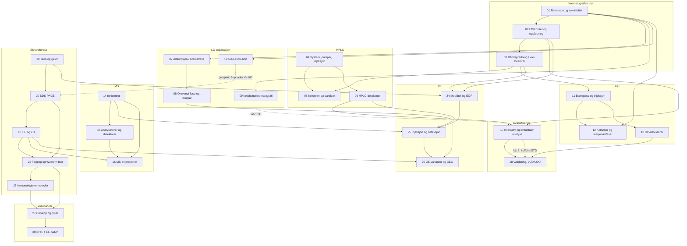

## Topic map

**Anbefalt leserekkefølge for eksamen (etter vekt):** 01 → 02 → 03 → 07 → 08 → 09 → 10 → 11 → 12 → 13 → 17 → 18 → 19 → 20 → 21 → 22 → 24 → 25 → 26 → 27 → 28 → 23 → 04 → 05 → 06 → 14 → 15 → 16.

**Labkobling:** Lab 1 (ionekromatografi) → side 09 og 17. Lab 2 (koffein med intern standard, HPLC) → side 08, 17 og 18. Prosjektoppgave (proteinidentifisering: SEC med Sephadex G-100 → SDS-PAGE → MS) → side 10, 20, 16 og 22.
